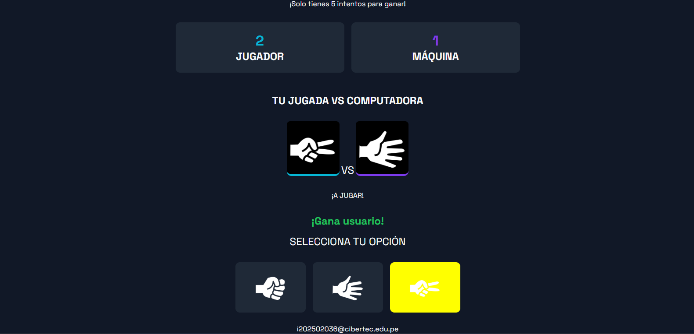

# ✊✋✌️ Piedra, Papel o Tijeras

Juego clásico de Piedra, Papel o Tijeras desarrollado con HTML, CSS y JavaScript puro.
Primer desafio de DEW - Cibertec.

## 📋 Descripción

Esta aplicación permite al usuario jugar contra la máquina en partidas de Piedra, Papel o Tijeras. La elección de la máquina se genera aleatoriamente y el sistema determina automáticamente el ganador de cada ronda.

El juego incorpora un sistema de puntuación, contador de partidas y finalización automática al alcanzar el límite máximo configurado.

## 🚀 Características

- Selección de Piedra, Papel o Tijeras mediante botones.
- Generación aleatoria de jugadas de la máquina.
- Visualización gráfica de las elecciones mediante imágenes.
- Contador de puntuación del jugador.
- Contador de puntuación de la máquina.
- Control de número máximo de partidas.
- Mensaje de resultado al finalizar el juego.
- Reinicio automático de la partida utilizando SweetAlert2.

## 🛠️ Tecnologías utilizadas

- HTML5
- CSS3
- JavaScript (ES6)
- SweetAlert2

## 📂 Estructura del proyecto

```text
├── index.html
├── css/
│   └── styles.css
├── js/
│   └── app.js
├── assets/
│   └── icons/
│       ├── rock.png
│       ├── paper.png
│       └── scissors.png
└── README.md
```

## 🎮 Reglas del juego

- Piedra gana a Tijeras.
- Tijeras gana a Papel.
- Papel gana a Piedra.
- Si ambos jugadores eligen la misma opción, se produce un empate.

## ⚙️ Instalación

1. Clonar el repositorio:

```bash
git clone https://github.com/PierreLogs/rock_paper_scissors_game
```

1. Acceder al directorio:

```bash
cd piedra-papel-tijeras
```

1. Abrir el archivo `index.html` en el navegador.

## 📸 Capturas



## 🧠 Aprendizajes aplicados

Durante el desarrollo de este proyecto se practicaron conceptos de:

- Variables y constantes.
- Funciones.
- Eventos del DOM.
- Manipulación del DOM.
- Condicionales.
- Estructuras de control.
- Operadores lógicos.
- Generación de números aleatorios.

## 👨‍💻 Autor

**Luis Pierre Oscco Lara**

- GitHub: <https://github.com/PierreLogs>
- Email: <i202502036@cibertec.edu.pe>

## 📚 Referencias

- DEW - Unidad 1 Tema 1 (Cibertec)
- DEW - Unidad 1 Tema 2 (Cibertec)
- JavaScript Inspirate - Ulises Gascón González
- JavaScript Pocket Reference (David Flanagan)
- Eloquent JavaScript - Marijn Haverbeke

## 📄 Licencia

Este proyecto fue desarrollado con fines educativos y de aprendizaje.
